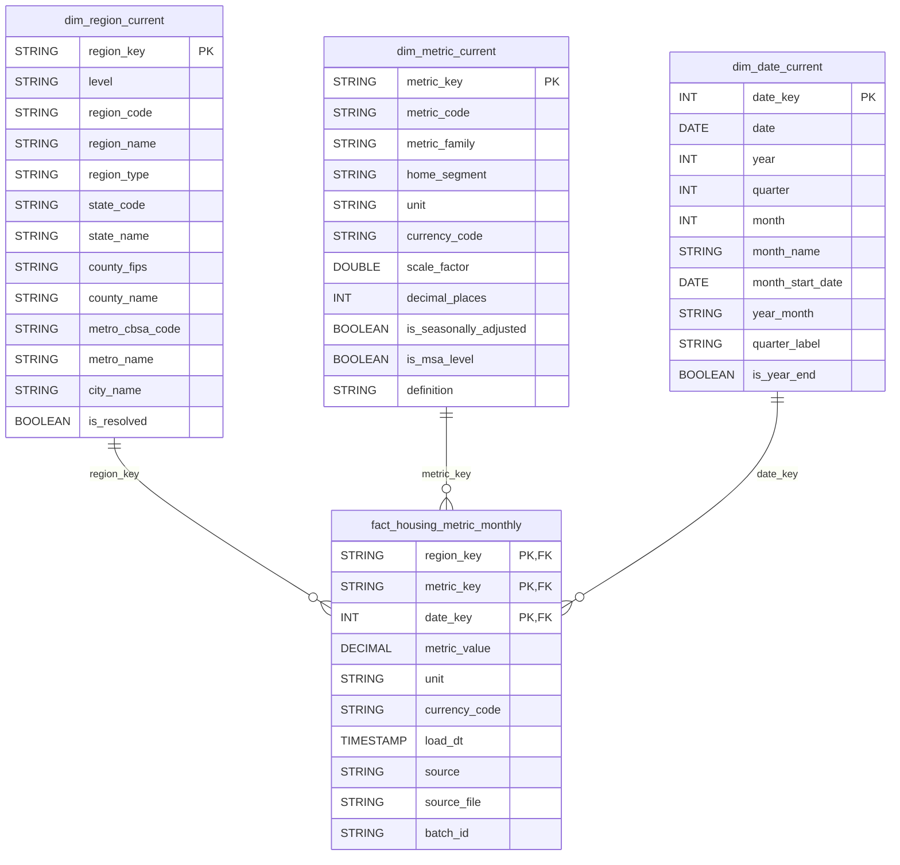

# Gold data model (star schema)

Built by the Lakeflow pipeline `vstone_gold_dlt` (job **vstone_gold**, triggered from GitHub Actions).
Generated from `src/vstone_framework/gold_schema.py` - the same definitions the pipeline uses to declare the tables.

## ER diagram

## How the dimensions are built

| Table | Type | Rows | Keys |
|---|---|---|---|
| `dim_date` | **Type 0** (static calendar, generated from Silver's date range) | one row per month-end, never versioned | `date_key` (yyyyMMdd) |
| `dim_region` | **Type 2** (AUTO CDC from a snapshot of Silver) | every version of every region; `__START_AT` / `__END_AT` mark validity | business key `region_key` + `__START_AT` |
| `dim_metric` | **Type 1** (AUTO CDC from a snapshot, overwrite) | one row per metric; no history columns | `metric_key` |
| `dim_date_current`, `dim_region_current`, `dim_metric_current` | materialized views | one row per key (`dim_region`: the open version, `__END_AT IS NULL`) | PRIMARY KEY on the business key |
| `fact_housing_metric_monthly` | materialized view, Liquid Clustering on metric_key, region_key, date_key | one row per region x metric x month | PRIMARY KEY (region_key, metric_key, date_key), 3 FOREIGN KEYs |

Only `dim_region` keeps history. Each pipeline update compares the new Silver snapshot with the previous one: a changed attribute (e.g. a region
name corrected in a crosswalk) closes the old version (`__END_AT` set) and opens a new one. The fact references
the current dimensions, so queries always join to one row per key.

Snapshots carry business columns only - a load timestamp would differ on every run and create a false new version.

## Tables

### `dim_date_current`

Gold: current row of every date - primary key date_key, referenced by the fact

| Column | Type | Key | Description |
|---|---|---|---|
| `date_key` | INT | PK | Surrogate date key yyyyMMdd (primary key) |
| `date` | DATE |  | Month-end date |
| `year` | INT |  | Calendar year |
| `quarter` | INT |  | Calendar quarter 1-4 |
| `month` | INT |  | Calendar month 1-12 |
| `month_name` | STRING |  | Month name, e.g. January |
| `month_start_date` | DATE |  | First day of the month |
| `year_month` | STRING |  | yyyy-MM, e.g. 2017-12 |
| `quarter_label` | STRING |  | Quarter label, e.g. 2017-Q4 |
| `is_year_end` | BOOLEAN |  | True for December |

### `dim_region_current`

Gold: current row of every region - primary key region_key, referenced by the fact

| Column | Type | Key | Description |
|---|---|---|---|
| `region_key` | STRING | PK | Business key '<level>:<region_code>' (primary key) |
| `level` | STRING |  | Geography level: state, metro, county, city, neighborhood, zip |
| `region_code` | STRING |  | Standardised region code (county FIPS zero-padded to 5 digits) |
| `region_name` | STRING |  | Display name, e.g. 'Baldwin, AL'; the code itself when no crosswalk exists |
| `region_type` | STRING |  | regional, or national for the United States series |
| `state_code` | STRING |  | 2-letter state code |
| `state_name` | STRING |  | Full state name |
| `county_fips` | STRING |  | 5-digit county FIPS (from the county crosswalk) |
| `county_name` | STRING |  | County name (from the county crosswalk) |
| `metro_cbsa_code` | STRING |  | CBSA code of the metro (from the county crosswalk) |
| `metro_name` | STRING |  | Metro name (from the county crosswalk) |
| `city_name` | STRING |  | City name (from the city crosswalk) |
| `is_resolved` | BOOLEAN |  | True when names were found in a crosswalk |

### `dim_metric_current`

Gold: current row of every metric - primary key metric_key, referenced by the fact

| Column | Type | Key | Description |
|---|---|---|---|
| `metric_key` | STRING | PK | Standardised (snake_case) metric name (primary key) |
| `metric_code` | STRING |  | Original Zillow column name |
| `metric_family` | STRING |  | Measure family from the Zillow data dictionary, e.g. ZHVI |
| `home_segment` | STRING |  | Home type / size / tier, e.g. AllHomes, 3Bedroom, TopTier |
| `unit` | STRING |  | USD, USD_PER_MONTH, USD_PER_SQFT, USD_PER_SQFT_PER_MONTH, PERCENT, COUNT, DAYS or RATIO |
| `currency_code` | STRING |  | Reporting currency for money units (USD); NULL otherwise |
| `scale_factor` | DOUBLE |  | Multiplier applied during normalisation |
| `decimal_places` | INT |  | Precision the value is rounded to |
| `is_seasonally_adjusted` | BOOLEAN |  | True when the series is seasonally adjusted or smoothed |
| `is_msa_level` | BOOLEAN |  | True for metro-level (MSA) sale series |
| `definition` | STRING |  | Business definition from the Zillow data dictionary |

### `fact_housing_metric_monthly`

Gold fact: one normalised value per region, metric and month (grain region x metric x month)

| Column | Type | Key | Description |
|---|---|---|---|
| `region_key` | STRING | PK FK -> dim_region_current | Region (foreign key to dim_region_current) |
| `metric_key` | STRING | PK FK -> dim_metric_current | Metric (foreign key to dim_metric_current) |
| `date_key` | INT | PK FK -> dim_date_current | Month (foreign key to dim_date_current) |
| `metric_value` | DECIMAL(18,4) |  | Normalised value in the metric's unit (USD for money) |
| `unit` | STRING |  | Unit of metric_value |
| `currency_code` | STRING |  | USD for money units, else NULL |
| `load_dt` | TIMESTAMP |  | Audit: when the Gold pipeline wrote the row |
| `source` | STRING |  | Audit/lineage: rule set that produced the row (gold_dlt) |
| `source_file` | STRING |  | Audit/lineage: Silver table(s) the row was built from |
| `batch_id` | STRING |  | Audit: Gold pipeline id |

### `agg_top10_regions_by_home_value`

Gold aggregate: top 10 regions by typical home value (ZHVI) in the latest month, per geography level

| Column | Type | Key | Description |
|---|---|---|---|
| `level` | STRING | PK | Geography level the ranking is for |
| `rank_in_level` | INT | PK | 1 = highest typical home value in the level |
| `region_key` | STRING |  | Region business key |
| `region_name` | STRING |  | Region display name |
| `state_code` | STRING |  | 2-letter state code (when known) |
| `date` | DATE |  | Latest month with data for the level |
| `home_value_usd` | DECIMAL(18,4) |  | Typical home value (ZHVI, all homes), USD |
| `home_value_yoy_pct` | DOUBLE |  | Change versus the same month one year earlier, percent |
| `load_dt` | TIMESTAMP |  | Audit: when the Gold pipeline wrote the row |
| `source` | STRING |  | Audit/lineage: rule set that produced the row (gold_dlt) |
| `source_file` | STRING |  | Audit/lineage: Silver table(s) the row was built from |
| `batch_id` | STRING |  | Audit: Gold pipeline id |

### `agg_monthly_market_trend`

Gold aggregate: monthly housing market trend per state - home value, rent, prices, sales and growth features (Genie source)

| Column | Type | Key | Description |
|---|---|---|---|
| `region_key` | STRING | PK | Region business key |
| `region_name` | STRING |  | State name, or United States |
| `state_code` | STRING |  | 2-letter state code; NULL for the United States |
| `region_type` | STRING |  | regional or national |
| `date` | DATE |  | Month-end date |
| `date_key` | INT | PK | yyyyMMdd |
| `year` | INT |  | Calendar year |
| `month` | INT |  | Calendar month 1-12 |
| `home_value_usd` | DOUBLE |  | Typical home value (ZHVI, all homes), USD |
| `monthly_rent_usd` | DOUBLE |  | Typical monthly rent (ZRI, all homes), USD |
| `median_listing_price_usd` | DOUBLE |  | Median asking price, USD |
| `homes_sold` | DOUBLE |  | Number of homes sold in the month |
| `zhvi_mom_pct` | DOUBLE |  | Month-over-month change in typical home value (ZHVI_AllHomes), percent |
| `zhvi_yoy_pct` | DOUBLE |  | Year-over-year change in typical home value (ZHVI_AllHomes), percent |
| `zri_yoy_pct` | DOUBLE |  | Year-over-year change in typical rent (ZRI_AllHomes), percent |
| `gross_rent_yield_pct` | DOUBLE |  | Annual rent as a share of home value: ZRI x 12 / ZHVI x 100 (affordability / investor yield) |
| `tier_spread_ratio` | DOUBLE |  | Top-tier home value divided by bottom-tier home value (price inequality within the region) |
| `listing_premium_pct` | DOUBLE |  | How far median asking price is above (+) or below (-) typical home value, percent |
| `load_dt` | TIMESTAMP |  | Audit: when the Gold pipeline wrote the row |
| `source` | STRING |  | Audit/lineage: rule set that produced the row (gold_dlt) |
| `source_file` | STRING |  | Audit/lineage: Silver table(s) the row was built from |
| `batch_id` | STRING |  | Audit: Gold pipeline id |

### `agg_state_sales_summary`

Gold aggregate: homes sold, sale price, home value and asking price per state and year

| Column | Type | Key | Description |
|---|---|---|---|
| `state_code` | STRING | PK | 2-letter state code |
| `state_name` | STRING |  | Full state name |
| `year` | INT | PK | Calendar year |
| `months_reported` | BIGINT |  | Months with sales data in the year |
| `homes_sold` | DECIMAL(18,4) |  | Total homes sold in the year |
| `avg_sale_price_usd` | DECIMAL(18,4) |  | Average of the monthly median sale prices, USD |
| `avg_home_value_usd` | DECIMAL(18,4) |  | Average typical home value (ZHVI), USD |
| `avg_listing_price_usd` | DECIMAL(18,4) |  | Average median asking price, USD |
| `load_dt` | TIMESTAMP |  | Audit: when the Gold pipeline wrote the row |
| `source` | STRING |  | Audit/lineage: rule set that produced the row (gold_dlt) |
| `source_file` | STRING |  | Audit/lineage: Silver table(s) the row was built from |
| `batch_id` | STRING |  | Audit: Gold pipeline id |

### `agg_market_churn` (Day 7)

Gold aggregate: churn-style status of every region - active, cooling (home value falling for N months) or inactive (no data for N months)

| Column | Type | Key | Description |
|---|---|---|---|
| `region_key` | STRING | PK | Region business key |
| `level` | STRING |  | Geography level |
| `region_name` | STRING |  | Region display name |
| `state_code` | STRING |  | 2-letter state code (when known) |
| `last_data_date` | DATE |  | Last month with a home value for the region |
| `months_since_last_data` | INT |  | Months between the region's last value and the latest month of its level |
| `consecutive_monthly_declines` | INT |  | Months in a row the home value fell, up to the last month |
| `last_home_value_usd` | DECIMAL(18,4) |  | Home value (ZHVI) in the last month, USD |
| `status` | STRING |  | active, cooling (falling for N months) or inactive (no data for N months) |
| `load_dt` | TIMESTAMP |  | Audit: when the Gold pipeline wrote the row |
| `source` | STRING |  | Audit/lineage: rule set that produced the row (gold_dlt) |
| `source_file` | STRING |  | Audit/lineage: Silver table(s) the row was built from |
| `batch_id` | STRING |  | Audit: Gold pipeline id |

### `agg_market_churn_summary` (Day 7)

Gold aggregate: churn rate per geography level and state

| Column | Type | Key | Description |
|---|---|---|---|
| `level` | STRING | PK | Geography level |
| `state_code` | STRING | PK | 2-letter state code; UNKNOWN when the level has no state |
| `regions` | BIGINT |  | Regions with a home value series |
| `active_regions` | BIGINT |  | Regions with status active |
| `cooling_regions` | BIGINT |  | Regions with status cooling |
| `inactive_regions` | BIGINT |  | Regions with status inactive |
| `churn_rate_pct` | DOUBLE |  | (cooling + inactive) / regions x 100 |
| `load_dt` | TIMESTAMP |  | Audit: when the Gold pipeline wrote the row |
| `source` | STRING |  | Audit/lineage: rule set that produced the row (gold_dlt) |
| `source_file` | STRING |  | Audit/lineage: Silver table(s) the row was built from |
| `batch_id` | STRING |  | Audit: Gold pipeline id |
